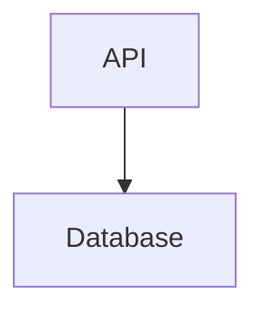

# nodespec

A file format and test suite for diagrams that must survive version control.

Every nodespec file is a [Mermaid](https://mermaid.js.org/) flowchart. nodespec
adds no syntax, only rules: each node is declared by name, and an edge may only
use a declared name.



The rule exists because of a silent wrong merge. One branch renames or deletes
a node and the other still uses it. Git merges both cleanly, and Mermaid quietly
draws a new node for the old name. Under nodespec, that merged file is refused:

```text
`db` is named by an edge and declared nowhere [undeclared-id]
```

Coordinates aren't the problem in a diagram, unlike cell references in a
spreadsheet: a clean merge of two moves gives exactly both moves. What decides
whether a diagram survives git is how it is written down.
[`DESIGN-BRIEF.md`](DESIGN-BRIEF.md) has the reasoning.

## Status

Draft 0. [`SPEC.md`](SPEC.md) is the format, `conformance/cases/` encodes it, and
`reference/nodespec/` is a checker for it. It is not on PyPI. The first surface
is flowcharts with named nodes.

The wrong merge above was shown in constructed cases that met a criterion fixed
before they ran. An experiment on real history ended with no verdict.
[The status page](docs/status.md) has the detail.

## Try it

From a clone, with [uv](https://docs.astral.sh/uv/) and
[just](https://just.systems/):

```sh
git clone https://github.com/kindspec/nodespec
cd nodespec
just setup
just run diagram.mmd    # exit 0 if accepted, 1 if refused
```

## Develop

```sh
just check      # format and lint
just conform    # the conformance cases against the checker
just mutants    # break the checker; the tests must notice
```

## More

- [`DESIGN-BRIEF.md`](DESIGN-BRIEF.md): what was decided and measured before the
  format was written.
- [`docs/adjudications/0001-mermaid-profile.md`](docs/adjudications/0001-mermaid-profile.md):
  the decision that defines draft 0.
- [`existence/RESULT.md`](existence/RESULT.md): the constructed wrong merges.
- [kindspec](https://github.com/kindspec): the other formats.
