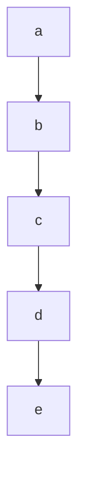

<!-- SPDX-License-Identifier: CC-BY-4.0 -->
# nodespec — specification, draft 0

Status: draft. This document writes up the profile that
`docs/adjudications/0001-mermaid-profile.md` (here, 0001) decides,
under its rules D1 to D5. **Where this document and 0001 disagree,
0001 wins and this document is in error.** Where 0001 is silent on
something the grammar has to decide, the text takes a reading, marks
it **(provisional)**, and lists it in §12. Each provisional reading
waits for the owner.

There is no conformance suite yet. Its cases are to be written from
this text alone, by someone who has not written a checker, and a
reference checker is then run against them unchanged, under a mutation
gate (0001, *What is decided already*). Every rule below is meant to be
decidable from this text without reading Mermaid's source.

---

## 1. What this format is for

A diagram of named nodes that several people edit, in git, over years,
where a merge that is quietly wrong about which nodes exist is worse
than a merge that fails.

Every nodespec file is a Mermaid flowchart. nodespec adds rules; it
adds no syntax (0001). The rules make loud the silent wrong merge that
`existence/RESULT.md` found: one branch renames or deletes a name, the
other still uses it, and Mermaid, which makes a node of any name an
edge uses, shows nothing. Under D1 the merged file names an id that no
statement declares, and the file is refused.

## 2. What this document decides

Specified here: the accepted file, as a grammar (§3, §4); what declares
an id and what names one (§5); membership (§6); the order rule (§7);
how a file is checked (§8); and the refusals, each with an identifier
(§9).

Not specified: how Mermaid lays out or renders a file; what a label
says, or how Mermaid renders its text; editor behaviour; how a refusal
is worded; and how a tool merges. A checker accepts a file or refuses
it; the profile defines no other value.

**Mermaid** in this document means Mermaid 12.1.0, as
`spike/mermaid/PRE-REGISTRATION.md` §4.4 pins it: Node v24.20.0,
`mermaid@12.1.0` and `jsdom@26.1.0` from the committed lockfile,
`securityLevel: "strict"`, `flowchart.htmlLabels: false` and
`maxEdges: 100000`. Each statement here about what Mermaid does was
checked against that install. The grammar is written so that every
file it accepts parses in Mermaid, with the nodes, edges, edge ids,
members, directions and classes this document reads from it, classes
as Mermaid's renderer receives them. Before Mermaid parses a file it
removes comments and directives and rewrites some quotes; §4.2 and
§4.5 refuse every text those steps would change in any way other than
removing whole comment lines and normalising line ends, so the claim
covers them. A file this document accepts that Mermaid reads otherwise
is a defect in this document.

A nodespec file is one whole file holding one flowchart. A Mermaid
fence inside a Markdown file is outside draft 0 **(provisional)**. (Not
normative: such files are conventionally named `*.mmd`.)

## 3. Encoding and lines

**A file is UTF-8 (provisional).** Bytes that are not well-formed
UTF-8 are refused as `bad-encoding`.

**A file that begins with a byte-order mark is refused as `leading-bom`
(provisional).** Mermaid ignores a leading U+FEFF. Refusing it now can
be relaxed later without making any accepted file invalid. The mark is
not part of the first line: the lines are read as if it were absent.

A line ends at LF, or at CR followed by LF; the line ending is not part
of the line. The last line need not end with one. **A CR that is not
followed by LF is refused as `lone-cr` (provisional).** Mermaid reads a
lone CR as a line end and git does not, so to git a file whose lines
end in CR is one line, and every two edits to it touch the same line.

A file refused as `bad-encoding` or `lone-cr` is checked no further
(§9).

`WSP` is a space (U+0020) or a tab (U+0009), and nothing else. Other
whitespace characters, such as U+00A0, never match `WSP`.

Nothing is normalised. Ids and keywords compare exactly, by code point,
so `End` and `end` are different words.

## 4. The grammar

### 4.1 Notation, and the whole grammar

ABNF (RFC 5234). **String literals are case-sensitive**, as RFC 7405's
`%s` prefix marks them; this document leaves the prefix out for
readability. `ALPHA` and `DIGIT` are ASCII letters and digits only;
`HEXDIG` is `DIGIT` or `A` to `F` in either case.

```abnf
WSP          = SP / HTAB
lchar        = HTAB / %x20-21 / %x23-27 / %x2A-3F / %x41-5A / %x5C
             / %x5E-7A / %x7E / nonascii
               ; a label character: not [ ] ( ) { } | " @
lead         = %x21 / %x23-27 / %x2A-2C / %x2E / %x30-3F / %x41-5A
             / %x5E-7A / %x7E / nonascii
               ; an lchar that is not WSP, - / or \
qchar        = HTAB / %x20-21 / %x23-7E / nonascii   ; not "
nonascii     = %xA0-2027 / %x202A-D7FF / %xE000-10FFFF
               ; not U+2028 or U+2029 (§4.2)
cchar        = HTAB / %x20-7E / nonascii

id           = 1*( ALPHA / DIGIT / "_" )                  ; §4.4
dir          = "TB" / "TD" / "BT" / "LR" / "RL"

blank        = *WSP
comment      = *WSP "%%" ( HTAB / %x20-7A / %x7C-7E / nonascii )
               *cchar                       ; next is not "{"
header       = *WSP ( "flowchart" / "graph" ) [ 1*WSP dir ] *WSP

node-stmt    = *WSP id shape *WSP                         ; §4.5
shape        = "[" label "]"     / "(" label ")"
             / "([" label "])"   / "[[" label "]]"
             / "[(" label ")]"   / "((" label "))"
             / ">" label "]"     / "{" label "}"
             / "{{" label "}}"   / "[/" label "/]"
             / "[\" label "\]"   / "[/" label "\]"
             / "[\" label "/]"   / "(((" label ")))"
label        = unquoted / quoted
unquoted     = *WSP lead *lchar
quoted       = DQUOTE 1*qchar DQUOTE

edge-stmt    = *WSP group 1*( 1*WSP [ id "@" ] link
               [ "|" label "|" ] 1*WSP group ) *WSP       ; §4.6
group        = id *( 1*WSP "&" 1*WSP id )
link         = 2*"-" ">" / 3*"-" / 2*"-" "o" / 2*"-" "x"
             / "<" 2*"-" ">" / "o" 2*"-" "o" / "x" 2*"-" "x"
             / "-" 1*"." "->" / "-" 1*"." "-"
             / 2*"=" ">" / 3*"="
             / 3*"~"
edge-decl    = *WSP dgroup 1*( 1*WSP [ id "@" ] link
               [ "|" label "|" ] 1*WSP dgroup ) *WSP
dgroup       = dend *( 1*WSP "&" 1*WSP dend )
dend         = id [ shape ]

subgraph-line = *WSP "subgraph" 1*WSP id [ *WSP "[" label "]" ]
                                                          ; §4.7
end-line     = *WSP "end" *WSP
member-line  = *WSP id *WSP
direction-stmt = *WSP "direction" 1*WSP dir *WSP

classdef-stmt = *WSP "classDef" 1*WSP id 1*WSP style-list *WSP
class-stmt   = *WSP "class" 1*WSP id *( "," id ) 1*WSP id
style-stmt   = *WSP "style" 1*WSP id 1*WSP style-list *WSP
style-list   = style-item *( "," style-item )             ; §4.8
style-item   = name ":" *SP value
value        = word *( 1*SP word )
word         = colour / number / [ "!" ] name
colour       = "#" 1*HEXDIG
number       = ( [ "-" ] 1*DIGIT [ "." 1*DIGIT ] / "." 1*DIGIT )
               [ unit ] [ "%" ]
unit         = 1*%x61-7A
name         = ALPHA *( ALPHA / DIGIT / "_" )
               *( "-" 1*( ALPHA / DIGIT / "_" ) )
```

A production matches a line only if it matches the whole line. Two
constraints that ABNF does not carry are part of the productions, so a
line that breaks one does not match:

- a `comment` does not hold `="` (§4.2);
- an `unquoted` label does not hold `~~~` (§4.5);
- a `quoted` label holds at least one character that is not `WSP`, does
  not begin with `` ` ``, and does not end with `=` (§4.5);
- a `unit` is not the one-letter word `v`, so `vh` is a unit; neither a
  `name` nor the part of it before its first `-` is `v` or one of the
  17 words listed in §4.4; a `name` is not `swimlane-beta` and does not
  begin with `swimlane-beta-`; and the `name` before a `:` is not
  `accTitle` or `accDescr` (§4.8).

Two more are refusals of their own: an `id` that is reserved, in a line
that matches, is `reserved-id` (§4.4); and text that Mermaid reads as a
direction statement, in any line but a comment or a direction
statement, is `stray-direction` (§4.9).

### 4.2 Lines

Each line is classified by the first rule below that matches it. A line
that is classified is never also read as something else.

1. **Front matter.** If the file's first line is `---`, with any `WSP`
   before or after it, that line and every line up to and including the
   next such line, or to the end of the file if there is none, are
   refused together as `not-admitted` (§4.10). Mermaid's matcher takes
   `---` with trailing whitespace, and indented only when both fences
   are indented alike; with one fence indented, or the two indented
   differently, Mermaid does not parse the file. The profile refuses
   every one of these forms the same way. These lines are not
   statement lines, so the header comes after them.
2. **A conflict marker**: the line's first seven characters are seven
   `<`, seven `=`, seven `>` or seven `|`. Refused as
   `conflict-marker`.
3. **A directive**: the line holds `%%{` anywhere, in a comment or a
   label included. Refused as `not-admitted` (§4.10). Mermaid reads
   `%%{` as the start of a directive wherever it stands and removes the
   text up to the next `}%%`, across lines: a comment `%% see %%{x`
   above an edge statement removes the edge.
4. **A blank line** matches `blank`. It is allowed anywhere.
5. **A comment** matches `comment`. It is allowed anywhere, inside a
   block included **(provisional, as are blank lines in a block)**, and
   is otherwise ignored. A comment has its own line: Mermaid refuses
   `%%` after a statement on the same line. A line holding only `%%`,
   with nothing after it, is not a comment; Mermaid reads it as a node
   named `%%`. A comment holding `="` is not a comment either, because
   Mermaid rewrites quotes before it removes comments (§4.5), so `="`
   in a comment changes a later label; such a line is a statement line.
   After the header it is `malformed-line`; before the header it is the
   first statement line, and §4.3's header rule makes it `no-header`.
6. Every other line is a **statement line**. The first statement line
   of a file is the header's place (§4.3); later statement lines are
   classified by §4.3's rules.

U+2028 and U+2029 are left out of every character class: Mermaid's
comment stripper reads each as a line end, so `a[x<U+2028>%% y]` loses
the rest of its line. A line holding either matches no production.

### 4.3 The header, and statement lines

**The first statement line is the header**: `flowchart` or `graph`,
then optionally a direction. Blank lines and comments may come before
it. A file with no statement line is refused as `no-header`. A first
statement line that does not match `header` is refused as `no-header`,
and the lines after it are classified as if a header stood in its
place **(provisional)**. A header in another case (`Flowchart`), with
another direction (`td`, `<`, `v`), with `flowchart-elk`, or with a
`;` after it does not match. The direction is optional, as in the
spike's subset **(provisional)**.

`flowchart-elk` is not admitted **(provisional)**. It chooses a layout
engine, which Mermaid also lets configuration choose,
and configuration is not admitted (§4.10).

After the header, the **first word** of a statement line is its text
after leading `WSP`, up to the next `WSP` or the end of the line. *In a
block* means after a subgraph line that opened a block and before the
`end-line` that closes it (§4.7); everywhere else is the *top level*.
A statement line is classified by the first rule below that applies:

1. First word `subgraph`: in a block, `nested-block`, whether or not
   the line is well formed. At the top level, §4.7: it opens a block,
   or is `subgraph-without-id`, or is `malformed-line`.
2. First word `end`: if the line matches `end-line`, it closes the
   open block, or at the top level is `unbalanced-block`. Otherwise
   `malformed-line`.
3. First word `direction`: if the line matches `direction-stmt`, it is
   a direction statement in a block (§4.9), or at the top level
   `direction-outside-block`. Otherwise `malformed-line`.
4. First word `classDef`, `class` or `style`: in a block,
   `statement-in-block`. At the top level, if the line matches
   `classdef-stmt`, `class-stmt` or `style-stmt` for its first word, it
   is that statement (§4.8); otherwise `malformed-line`.
5. First word `linkStyle`: `link-style`.
6. First word `click`; or the line begins, after `WSP`, with `accTitle`
   then `:`, or with `accDescr` then `:` or `{`, with any `WSP` between
   them: `not-admitted`.
7. Matches `node-stmt`: in a block, `declaration-in-block`; at the top
   level, a node statement, which declares a node (§5.1).
8. Matches `edge-stmt`: in a block, `statement-in-block`; at the top
   level, an edge statement (§4.6).
9. Matches `edge-decl`: in a block, `statement-in-block`; at the top
   level, `declaration-in-edge`.
10. Matches `member-line`: in a block, a member line (§6); at the top
    level, `malformed-line`.
11. Holds `:::` or `@{`, or a `"` directly followed by `` ` ``:
    `not-admitted`.
12. Anything else: `malformed-line`.

A file that ends inside a block is refused as `unbalanced-block`.

A bare id at the top level matches `member-line`, and is
`malformed-line` there. It is not a declaration: a declaration names a
shape (0001, *What it costs*).

`;` is not admitted anywhere outside a label (the owner, 2026-10-19:
refused for now), so a statement line ending in `;`, two statements on
one line, and a member line `a;` are `malformed-line`, and a header
ending in `;` is `no-header`. Mermaid accepts `;` as a statement
separator, and reads it differently by statement and by what precedes
it: `graph TD ;` does not parse; in a `classDef` or a `style`, after a
`#` colour, `fill:#f9f;stroke:#333` joins two styles into one, and
after a name word, `fill:red;stroke:blue` ends the statement and makes
a node named `stroke:blue`.

### 4.4 Ids

An id is one or more ASCII letters, digits and underscores. Mermaid
accepts more, including `-`, `.` and non-ASCII letters; the profile
does not **(provisional)**. Mermaid reads a word such as `end` or
`class` before a hyphen as its keyword, so `end-x[E]` and `class-a[E]`
do not parse; and `a&b --> c` makes one node named `a&b`.

**An id is refused as `reserved-id`** when it is one of these words,
compared exactly:

    end  graph  flowchart  subgraph  style  class  classDef  click
    linkStyle  interpolate  call  href  default  _self  _blank
    _parent  _top

Each is a Mermaid keyword: in at least one of the positions an id
takes (a node statement, an edge end, a member line, a subgraph id, an
edge id, a class, a class or style target), Mermaid does not parse it
or reads it as something else. `default` is among them, so
`classDef default`, Mermaid's class for every node, is refused
**(provisional)**.

**`hasOwnProperty` is reserved too (provisional).** Mermaid accepts
it as an id, but a block in which a member line naming it is followed
by another member line throws a `TypeError`
(`prims[type].hasOwnProperty is not a function`). The other names of
JavaScript's `Object.prototype` (`constructor`, `toString`, `__proto__`
and the rest) parse in every position, in that one included.

**A class may not be `node` (provisional)**: a `classDef` or `class`
naming the class `node` is refused as `reserved-id`. Mermaid applies
the styles of the classes `default` and `node` to every node, so
`classDef node`, like `classDef default`, styles every node without
naming one. `node`
remains an id for a node, a subgraph or an edge.

**`direction` is reserved too (provisional)**, and refused as
`reserved-id`. Mermaid accepts it as an id, but a line whose first word
is `direction` is read as a direction statement (§4.3), and one that
ends in it is `stray-direction` (§4.9), so as an id it would work in
some places and not others.

**An id of the form `L_`, one or more characters, `_`, one or more
characters, `_`, one or more digits, such as `L_a_b_0`, is refused as
`reserved-id` (provisional).** The characters may be any id
characters, `_` included **(provisional)**, so `L_a_b__0` has the form
(`a`, then `b_`, then `0`); in regular-expression terms the whole id
matches `L_.+_.+_[0-9]+`. Mermaid makes exactly that id for an edge
from `a` to `b_`, and drops a node statement `L_a_b__0[X]` that follows
the edge. Mermaid gives every edge without an edge id an id of that
form, `L_` start `_` end `_` a counter. A node statement whose id
equals an existing edge's id is dropped without a word; a node declared
before the edge keeps its id, and a `class` naming it then classes the
node and the edge.

`reserved-id` applies wherever an id stands in a line that §4.3
classifies as a statement and refuses for nothing else: in a
declaration and wherever it is named. A reserved word in a line that is
refused for another reason, such as a bare `graph` at the top level
(`malformed-line`), is not also `reserved-id` (§9). The `L_…` form is
reserved for ids only; a style word of that form, `fill:L_x_y_0`, is
an ordinary `name`.

### 4.5 Node statements and labels

A **node statement** is an id and a shape, with nothing between them:
`a [A]` does not parse in Mermaid. The shapes are Mermaid's classic
fourteen:

| shape | Mermaid's type | | shape | Mermaid's type |
| --- | --- | --- | --- | --- |
| `a[A]` | square | | `a{A}` | diamond |
| `a(A)` | round | | `a{{A}}` | hexagon |
| `a([A])` | stadium | | `a[/A/]` | lean_right |
| `a[[A]]` | subroutine | | `a[\A\]` | lean_left |
| `a[(A)]` | cylinder | | `a[/A\]` | trapezoid |
| `a((A))` | circle | | `a[\A/]` | inv_trapezoid |
| `a>A]` | odd | | `a(((A)))` | doublecircle |

**A label is unquoted or quoted.** An unquoted label has at least one
character that is not `WSP`; its first such character is not `-`, `/`
or `\`, since `(-`, `[/` and `[\` open other shapes; it holds none
of `[ ] ( ) { } | " @`; and it holds no `~~~`. Mermaid reads `~~~` at
the start of a label's text, or after a `/` or `\` in a trapezoid, as
an invisible link, so `a[~~~]`, `a[/x/~~~ y/]` and `a -->|~~~ x| b` do
not parse; the profile refuses `~~~` anywhere in an unquoted label,
which is simpler to check **(provisional)**. A quoted label may hold
it. A quoted label is `"`, then text without `"`,
then `"`, with nothing between the quotes and the delimiters around
them.
The text holds a character that is not `WSP`, and:

- does not begin with `` ` ``: `` "`…`" `` is a Markdown string,
  which is not admitted (§4.10);
- does not end with `=`. Before Mermaid parses a file it rewrites
  `="…"` to `='…'` between a `<` followed by a word character and the
  next `>`, wherever they are in the file; a quoted label ending in
  `=` makes `="` with its own closing quote, and the next label's
  opening quote is rewritten. Without `="` in the file the rewrite
  changes nothing.

`@` is left out of unquoted labels because Mermaid reads a run of
characters ending in `@` as an edge id, so `n[a@b]` does not parse;
quoted, `n["a@b"]` does.

**Labels are not identity.** The rules in §5 to §7 never read a label.
Mermaid trims a label's leading and trailing whitespace, and sanitises
text that looks like HTML: it reads `a[x<b]` as the text `x`. Those
are matters of rendering, which this document does not specify (§2).

### 4.6 Edge statements

An **edge statement** is a group of ids, then one or more links, each
followed by a group. A link may carry an edge id directly before it,
`a e1@--> b`, and a label directly after it, `a -->|yes| b`. Links and
`&` have `WSP` on both sides **(provisional)**: Mermaid also reads
`a-->b`, but without the spaces `A---oB` is a circle-headed link to `B`
and `a&b` is one node.

| link | Mermaid's kind |
| --- | --- |
| `-->`, `--->`, … | arrow, solid |
| `---`, `----`, … | open, solid |
| `--o`, `--x`, `---o`, … | circle or cross head, solid |
| `<-->`, `o--o`, `x--x`, `<--->`, … | both ends headed, solid |
| `-.->`, `-..->`, … | arrow, dotted |
| `-.-`, `-..-`, … | open, dotted |
| `==>`, `===>`, … | arrow, thick |
| `===`, `====`, … | open, thick |
| `~~~`, `~~~~`, … | invisible |

These are the spike's links (`spike/mermaid/PRE-REGISTRATION.md`,
Appendix A) with their longer forms. Mermaid accepts others that are
not admitted **(provisional)**: `<-.->`, `<==>`, `o-.-o` and `x==x`;
and a head at the start only, `o-->`, `x-->` or `<---`, which Mermaid
reads without that head. They are `malformed-line`. So is a label
written inside the link, `-- yes -->`, `-. yes .->` or `== yes ==>`
(the owner, 2026-10-19: refused for now): the pipe form says the same,
and the inline form's label ends at the first run of the link's own
characters.

**What edges a statement makes.** Each link makes one edge from every
id of the group before it to every id of the group after it, in that
order: `a & b --> c & d` makes four edges, and `a --> b --> c` makes
two. The edges of a file are a list, not a set: `a & a --> b` makes two
edges from `a` to `b`, and Mermaid keeps both.

**Two edges without edge ids that have the same start, the same end,
the same link and the same label are refused as `duplicate-edge`**
(the owner, 2026-10-19). The same link means the same characters
(`-->` and `--->` differ); the same label means both have none, or both
have one whose text between the `|`s is the same once leading and
trailing `WSP` is removed **(provisional)**. Labels are compared as
bytes, not as what they render, so `|x|` and `|"x"|` are different
labels and those two edges are not duplicates; that is deliberate,
since deciding which spellings render alike would need Mermaid's label
rules. An unnamed edge has no
identity but its ends, link and label, so two of them are one edge
written twice: both branches adding it in different places, or both
moving it, then merge loud instead of drawing it twice.

**A file whose statements make more than 500 edges is refused as
`too-many-edges`** (the owner, 2026-10-19). Mermaid's default
configuration accepts 500 edges and refuses 501 ("Edge limit
exceeded"); the profile's premise is that its files render wherever
Mermaid does, and a page's configuration is not the file's to choose.
§2's pinned `maxEdges: 100000` is for checking Mermaid's reading, not
a limit of the profile.

**An edge id is declared by the one edge that carries it** (D1). So an
edge id is allowed only on a link with one id on each side. **An edge
id on a link with `&` in the group before it or after it is refused as
`edge-id-on-group` (provisional).** Mermaid gives the id to one edge of
the group, from the group's last start to its first end, and the
others get automatic ids; an edit that adds an id to the group moves
the edge id to another edge without a word. `edge-id-on-group` applies
only to a line that §4.3 classifies as an edge statement (rule 8, at
the top level) **(provisional)**. A line refused as
`declaration-in-edge` or `statement-in-block` is not also
`edge-id-on-group`, since §4.2 reads a classified line as nothing
else.

### 4.7 Subgraph blocks

A **subgraph line** opens a block, and the next `end-line` closes it.
Blocks do not nest (D3, §6). A subgraph line is `subgraph`, its
explicit id, and optionally a title in `[ ]`: `subgraph cache`,
`subgraph cache [Cache tier]`, `subgraph cache["Cache tier"]`. The
title is a label (§4.5). **Nothing follows the title or the id, not
even `WSP`.** Mermaid refuses `subgraph s [T]` followed by a space, and
reads `subgraph s` followed by a space as a subgraph with no id, titled
`s`.

**A subgraph line with no explicit id is refused as
`subgraph-without-id`** (D1). It is a line whose first word is
`subgraph` and in which, after `subgraph` and the whole run of `WSP`
that follows it **(provisional)**, the text is empty, or begins with
`"`, or holds `WSP` before its first `[` (or anywhere, if it has none)
that is not followed, after any more `WSP`, by that `[`. Skipping the
whole run is how Mermaid reads it: `subgraph  s` with two spaces, and
`subgraph`, a tab and a space, then `s`, both give the subgraph the id
`s`. Those are the forms Mermaid refuses, or gives an id of its own or
an id holding a space: `subgraph` alone throws a
`TypeError`; `subgraph My Title`, `subgraph "My Title"` and
`subgraph s ` with a trailing space get an id `subGraphN` of Mermaid's
numbering; and `subgraph a1 b1 [T]` gets the id `a1 b1`. Any other
top-level line whose first word is `subgraph` and that does not match
`subgraph-line` is `malformed-line`.

`end-line` is `end` alone. Mermaid reads `end x` as the end of the
block and a node `x`.

### 4.8 `classDef`, `class` and `style`

`classDef c fill:#f9f,stroke:#333` declares the class `c` with a style
list. `class a,b c` gives the class `c` to `a` and `b`.
`style a fill:#f9f` styles `a`. Each statement is at the top level
(D3); what each may name is §5.2.

One statement, one class, one style target **(provisional)**:

- `classDef c1,c2 …`, which Mermaid reads as two classes, is
  `malformed-line`; each class has its own `classDef` line.
- `class a c1,c2` is `malformed-line`: Mermaid gives `a` one class
  named `c1,c2`.
- `style a,b …` is `malformed-line`: Mermaid styles a new node named
  `a,b`.

A `class` line ends at its class id: Mermaid refuses `WSP` after it.
`classDef` and `style` lines may end in `WSP`, which Mermaid keeps in
the last style.

**A style list** is narrower than what Mermaid accepts
**(provisional)**. Mermaid lexes a style as tokens of the diagram, so a
value that holds `--`, `-.`, `==`, `~~~`, `:::`, `>`, `(`, `"` or `@`,
or a word that begins with `&` or `*`, does not parse; nor does a word
that is a keyword, or that begins with a keyword and `-` (`class-x`,
`end-x`, `flowchart-elk`), or the word `v` alone, after a digit or `#`,
or before `-`; nor a property named `accTitle` or `accDescr`. `&`, `*`
and `::` inside a word do parse, and are still not admitted. `;` is
not admitted (§4.3). The grammar admits CSS-like items: a name, `:`,
and words that are a colour (`#f9f`), a number with an optional unit
and `%` (`4px`, `.5`, `50%`, `100vh`), or a name (`Arial`,
`sans-serif`, `!important`). A `unit` is any run of lower-case letters
except the one-letter `v`. Neither a `name` nor its part before its
first `-` is `v` or one of the 17 words listed in §4.4; the other
reserved ids, such as `hasOwnProperty` and `direction`, parse as style
words (`fill:hasOwnProperty`, `fill:direction-x`). A `name` is not
`swimlane-beta` and does not begin with `swimlane-beta-`, which Mermaid
lexes as a keyword (`swimlane` and `swimlane-x` parse). A property's
name is not `accTitle` or `accDescr`.

### 4.9 Direction

A **direction statement**, `direction LR`, sets a block's direction.
It stands only in a block **(provisional)**: at the top level it is
refused as `direction-outside-block`. Mermaid accepts it there and it
has no effect; the header carries the chart's direction. **A block
holds at most one direction statement (provisional)**: every direction
statement in a block after its first is refused as `direction-twice`,
the third and later ones included **(provisional)**. Mermaid keeps the
last, so two branches that each add one merge clean and one of them is
lost.

**Text Mermaid reads as a direction statement is refused as
`stray-direction`.** Mermaid's lexer reads any text that matches
`direction`, one or more whitespace characters, and one of `TB`, `BT`,
`RL`, `LR` or `TD`, as a direction statement, from wherever a token
starts to the end of that line; the whitespace may include line ends.
What it swallows is gone: `a[go direction LR]` declares no node, an
edge labelled `|direction RL|` is no edge, and a member line ending
in `direction` followed by a line starting with `LR` holds neither. So
a line other than a comment or a line that matches `direction-stmt` is
refused as `stray-direction` when **(provisional, in this exact
form)**:

- it holds `direction`, then one or more whitespace characters, then
  `TB`, `BT`, `RL`, `LR` or `TD`; or
- with trailing whitespace removed, it ends in `direction`.

Here, in both clauses **(provisional for the second)**, a whitespace
character is any of U+0009 to U+000D, U+0020,
U+00A0, U+1680, U+2000 to U+200A, U+2028, U+2029, U+202F, U+205F,
U+3000 and U+FEFF, which is what Mermaid's lexer counts; U+00A0 between
the words swallows the line as a space does. The text may stand
anywhere in the line: in a label, a title, a style, an id
(`xdirection LRX` matches). `stray-direction` applies whatever else
applies to the line. Comment lines are exempt because Mermaid removes
them before it lexes. **Front matter lines are exempt too
(provisional)**: Mermaid removes front matter before it lexes, so
`title: go direction LR` in it swallows nothing (the file is still
`not-admitted`, §4.2). **A directive line is not exempt
(provisional)**: Mermaid removes only the text from `%%{` to `}%%`, and
lexes what is left of the line, so `a[go direction LR %%{x}%%]`
declares no node. A directive line holding the text is refused as both
`not-admitted` and `stray-direction`.

**The words compare exactly (provisional, as Mermaid's lexer does)**:
`direction` in lower case, and `TB`, `BT`, `RL`, `LR` and `TD` in upper
case. `a[go direction lr]`, `a[go direction Lr]`, `a[go Direction LR]`
and `a[go DIRECTION LR]` each declare their node in Mermaid, and none is
`stray-direction`.

### 4.10 Not admitted, for now

0001 leaves open which Mermaid statements beyond the spike's subset the
profile admits (*Open, for the specification and its cases*). Until
each is decided with its reason, the profile refuses it: a refusal can
be relaxed later without making any accepted file invalid, and an
admission cannot be withdrawn without breaking files. The owner
confirmed that rule on 2026-10-19 for front matter, `%%{init}`
directives, `:::`, `;` and inline edge labels: each is refused for now
and may be admitted later.

Refused as `not-admitted`:

- **Front matter**, as §4.2 rule 1 reads it.
- **Directives**, any line holding `%%{` (§4.2 rule 3). Front matter
  and directives configure how Mermaid reads and draws the rest of the
  file, and the rules here were checked under one fixed configuration
  (§2).
- **`click`**, which attaches a link or a callback to a node; the
  spike's model carried it only as text (0001 names it open).
- **`accTitle` and `accDescr`**, which are not in the spike's subset.
- **`:::`**, a class given inside a node or edge statement. A class
  has one form, the `class` statement, which D4 orders; `a:::c --> b`
  would give a class from an edge statement, which D1 says names and
  declares nothing.
- **`@{ … }`**, Mermaid's newer shape and edge data form
  **(provisional)**. Its body is a YAML mapping that the grammar would
  have to pin, and on an edge id it changes that edge.
- **Markdown strings**, `` "`…`" `` in a label, which the spike's
  subset left out.

A line is `not-admitted` only as §4.2 and §4.3 say. So `:::`, `@{` and
a Markdown string are `not-admitted` only where §4.3 rule 11 reaches
them: in a node or edge statement, at the top level or in a block. In
a line whose first word is `subgraph`, `classDef`, `class` or `style`,
§4.3's rules 1 and 4 come first, and the same text is
`malformed-line`, a subgraph title in Markdown included
**(provisional)**. Other forms
Mermaid accepts and this grammar does not, such as `;`, `-- text -->`,
the other links, other ids, `classDef c1,c2` and `class a c1,c2`, are
`malformed-line`.

## 5. Declarations and names (D1, D2)

### 5.1 Declarations

**D1. Every id is declared exactly once, and everything else only
names it.** An id is declared by:

| declaration | kind |
| --- | --- |
| a node statement, at the top level | node |
| a subgraph line | subgraph |
| `id@` before a link in an edge statement | edge |
| a `classDef` line | class |

A node statement stands on its own line, outside every block. A
declaration inside an edge, `api[API] --> db`, matches `edge-decl` and
not `edge-stmt`, and is refused as `declaration-in-edge`: an edge that
could declare its end would let the other branch quietly redeclare a
node it renamed (0001, *Why*). A node statement inside a block is
`declaration-in-block` (§6).

**An id declared twice as the same kind is refused as
`duplicate-declaration`**: two node statements for `a`, two subgraph
lines for `s`, `e1@` on two links, two `classDef` lines for `c`. This
holds however alike the two declarations are. Mermaid would merge each
pair: a node keeps its last label and shape, a subgraph id fuses two
subgraphs, a second `e1@` gives that edge an automatic id instead, and
two `classDef` lines join their styles.

### 5.2 Names

Every other place an id stands names it. A name must be declared, by a
declaration anywhere in the file, before or after it; §7 orders `class`
lines. **An id that is named and not declared is refused as
`undeclared-id`.**

| statement | names | each may be |
| --- | --- | --- |
| edge statement | each id of its groups | node or subgraph |
| member line | its id | node or subgraph (D3) |
| `style` | its target | node or subgraph (D1) |
| `class` | each target | node, subgraph or edge (D1) |
| `class` | its last id, the class | class |

A `class` statement's targets are the ids before its last one.

**A statement that names an id declared as a kind it may not name is
refused as `wrong-kind`**: `style e1 …` where `e1` is an edge id, since
Mermaid drops a style on an edge without a word; `class a b` where `b`
is a node; an edge to an edge id or a class; a member line naming an
edge id. Mermaid accepts each and reads something other than what it
says: an edge to an edge id ends at no node, and an edge to a class
makes a node with the class's name. **`wrong-kind` applies to a name
only when the id is declared and none of its declarations is of a kind
that place may name.** An id declared both as a node and as a class is
`kind-clash` (§5.3), and an edge naming it is not also `wrong-kind`.

**An edge may end at a subgraph** (the owner, 2026-10-19). Mermaid
accepts one, and D1 still holds for it: an edge to a subgraph that the
other branch deleted names an undeclared id. What it does not catch, an
id reused as the other kind, is in §11.

### 5.3 One id, one kind

**D2. An id names a node, a subgraph, an edge or a class, never two of
them.** One namespace holds every id. **An id declared as two kinds is
refused as `kind-clash`**: a node and a subgraph both named `cache`, a
node and an edge id `e1`, a class and a node. Mermaid keeps both a
node and a subgraph of one name (the existence candidate 06, the
spike's I4), and drops a node statement whose id is an edge id
declared above it.

### 5.4 An example (not normative)

Under the profile, existence candidate 09 starts from



One branch deletes `c`, its node statement and its two edges; the other
adds `e --> c` after the last edge. Git merges them without a conflict,
and the merged file declares no `c` while `e --> c` names it. It is
refused as `undeclared-id` for `c`.

## 6. Membership (D3)

**D3. Membership is a member line.** Every block stands at the top
level. A block holds only member lines, direction statements, comments
and blank lines (§4.3; the comments and blank lines are
**(provisional)**):

- a node statement in a block is refused as `declaration-in-block`;
- an edge statement, or a `classDef`, `class` or `style` statement, in
  a block is refused as `statement-in-block`; an `edge-decl` in a block
  is `statement-in-block` too;
- a subgraph line in a block is refused as `nested-block`;
- an `end-line` with no open block, and a file that ends inside a
  block, are refused as `unbalanced-block`.

**A member line names one declared node or subgraph**, and makes the
block's subgraph its **holder**. A member line naming a subgraph nests
that subgraph in the block's subgraph. Mermaid nests a subgraph named
on a member line as it nests a block written inside another, whichever
of the two blocks comes first in the file. A member line holds one id:
Mermaid reads `a & b` in a block, and it is `malformed-line` here.

**A node or a subgraph has at most one holder.** An id named by more
than one member line is refused as `member-twice`. Where the two lines
are in two blocks, that is D3. Where both are in one block, refusing it
is **(provisional)**: the two lines say the same thing, and a later
edit that deletes one leaves the other. Mermaid puts an id named in two
blocks in whichever block it closes first, and says nothing.

**Nesting has no cycle.** Following holders from a subgraph never
returns to it. A cycle is refused as `membership-cycle`; a member line
naming its own block's subgraph is a cycle of one. Mermaid does not
refuse a cycle (0001).

## 7. Position (D4)

**D4. Nothing depends on position.**

**`linkStyle` is refused as `link-style`.** It styles edges by their
index in file order, so an edge added above it on another branch
silently restyles a different edge (0001).

**Every `class` line comes after every other statement line
(provisional).** That is 0001's "with class lines last", read
literally. A `class` line that has, anywhere after it, a statement line
that is not a `class` line is refused as `class-not-last`; only blank
lines, comments and other `class` lines may follow one. Two Mermaid
behaviours make the order matter:

- Mermaid drops a class given to a node, subgraph or edge not yet
  declared (0001).
- A `style` line, an edge or a member line that names a subgraph makes
  Mermaid create a vertex with the subgraph's id. When Mermaid hands
  the chart to its renderer, that vertex's class list replaces the
  subgraph's, and a vertex created after the `class` line has none:
  `class s c` followed by `style s …`, `a --> s` or a member line `s`
  renders `s` without `c`.

With every `class` line last, both are impossible, and moving a
declaration or adding a name on another branch cannot strip a class.
The rule also puts every `classDef` before every `class` line, which
Mermaid does not need.

**An id is the target of at most one `style` line and at most one
`class` line (provisional).** A second is refused as `styled-twice`.
Mermaid applies both, in file order, so where they set the same
property the later one wins; two branches that each style or class the
same id would merge clean, and the order of their lines would decide
the picture. With one class per `class` line (§4.8), this means **an
id carries at most one class (provisional)**. Mermaid lets an id carry
several, so this is a loss of expressiveness against Mermaid: a node
that needs two classes' styles needs one class that holds both.

Apart from `class` lines, D4 orders nothing. Declarations, edges,
blocks and `style` lines may come in any order: Mermaid creates a node
that an edge, a member line or a `style` names before its node
statement, and the node statement then gives it its label and shape.

## 8. Checking one file (D5)

**D5. The profile is checked, and refused, on the file alone.** A
checker reads one file and says either that it is in the profile or
which rule it breaks and, where the rule is about an id, which id. It
repairs nothing. A merge is checked by checking its result.

A checker needs no merge driver, clean or smudge filter, or hook, which
do not travel (rowspec `SPEC.md` §11). It needs no Mermaid either:
every rule here is a property of the file's text.

## 9. Refusals — normative

A file is either in the profile or refused. **This list is complete**:
every refusal draft 0 has is below. Each entry gives the identifier,
what it means, and the section it comes from.

A checker MUST refuse:

1. `bad-encoding`: bytes that are not well-formed UTF-8 (§3)
2. `leading-bom`: a byte-order mark at the start of the file (§3)
3. `lone-cr`: a CR not followed by LF (§3)
4. `conflict-marker`: a line that starts with seven `<`, `=`, `>` or
   `|` (§4.2)
5. `no-header`: no statement line, or a first one that is not a header
   (§4.3)
6. `malformed-line`: a statement line §4.3 sends to no other entry
   (§4.3)
7. `not-admitted`: front matter, `%%{`, `click`, `accTitle`,
   `accDescr`, or `:::`, `@{` or a Markdown string where §4.3 rule 11
   reaches it (§4.10)
8. `reserved-id`: an id that is reserved, or a class named `node`
   (§4.4)
9. `stray-direction`: text Mermaid would read as a direction statement
   where none stands (§4.9)
10. `subgraph-without-id`: a subgraph line with no explicit id (§4.7,
    D1)
11. `declaration-in-edge`: a node declared inside an edge statement
    (§5.1, D1)
12. `duplicate-declaration`: an id declared twice as one kind (§5.1,
    D1)
13. `undeclared-id`: an id named and declared nowhere (§5.2, D1)
14. `wrong-kind`: an id named where none of its kinds may be named
    (§5.2, D1, D2)
15. `kind-clash`: an id declared as two kinds (§5.3, D2)
16. `edge-id-on-group`: an edge id on a link with `&` on either side
    (§4.6, D1)
17. `duplicate-edge`: two unnamed edges with the same ends, link and
    label (§4.6)
18. `too-many-edges`: more than 500 edges (§4.6)
19. `declaration-in-block`: a node statement in a block (§6, D3)
20. `statement-in-block`: an edge, `classDef`, `class` or `style`
    statement in a block (§6, D3)
21. `nested-block`: a subgraph line in a block (§6, D3)
22. `unbalanced-block`: an `end` with no open block, or a block never
    closed (§4.3, §6)
23. `member-twice`: an id on more than one member line (§6, D3)
24. `membership-cycle`: subgraphs that hold one another (§6, D3)
25. `direction-outside-block`: a direction statement at the top level
    (§4.9)
26. `direction-twice`: a second direction statement in one block
    (§4.9)
27. `link-style`: a `linkStyle` line (§7, D4)
28. `class-not-last`: a `class` line with a statement line after it
    that is not a `class` line (§7, D4)
29. `styled-twice`: an id targeted by two `style` lines or two `class`
    lines (§7, D4)

**Which refusals apply (provisional).** One rule decides it:

- `bad-encoding` and `lone-cr` are about the whole file, and when
  either applies, nothing else is checked: both are reported when both
  apply, and `leading-bom` is not reported **(provisional)**.
- **A line that §4.2 to §4.10 refuses contributes nothing else.** It
  declares nothing, names nothing, opens and closes no block, and is
  not a member line, a direction statement, a `style` line, a `class`
  line or an edge for any later rule. The refusals of a single line are
  `conflict-marker`, `no-header` (for its line), `malformed-line`,
  `not-admitted` (front matter included), `reserved-id`,
  `stray-direction`, `subgraph-without-id`, `declaration-in-edge`,
  `edge-id-on-group`, `declaration-in-block`, `statement-in-block`,
  `nested-block`, `unbalanced-block` (for an `end-line`),
  `direction-outside-block`, `direction-twice` (for each direction
  statement in a block after the first) and `link-style`.
  `stray-direction` applies to a line whatever else applies to it,
  except to front matter lines, which §4.9 exempts; `reserved-id`
  applies only to a line that nothing else refuses (§4.4).
- Every other rule (`duplicate-declaration`, `undeclared-id`,
  `wrong-kind`, `kind-clash`, `duplicate-edge`, `too-many-edges`, the
  end-of-file `unbalanced-block`, `member-twice`, `membership-cycle`,
  `class-not-last` and `styled-twice`) is checked on the lines that are
  not refused.

So `a[A] --> b` declares nothing; a node statement in a block declares
nothing, and an edge naming that node is `undeclared-id` too; a refused
`subgraph` line opens no block, so its member lines are top-level
`malformed-line` and its `end` is `unbalanced-block`; and a
`no-header` line is followed by lines read as usual.

**Every refusal is reported with its identifier**, spelled exactly,
where a program can read it without parsing the message. The message
is free. **Some entries are about an id**, and are reported with one id
they apply to:

- `reserved-id`, `duplicate-declaration`, `undeclared-id`,
  `wrong-kind` and `kind-clash`: the id itself;
- `edge-id-on-group`: the edge id;
- `member-twice`: the id named on more than one member line;
- `membership-cycle`: a subgraph on the cycle;
- `styled-twice`: the id targeted twice.

The other entries are about a line or the whole file, and carry no id
**(provisional)**.

**Several refusals may apply to one file, and which one is reported is
not specified**, as in rowspec §9. A checker reports any one that
applies, with an id it applies to where the entry has one. A
conformance case names every identifier that applies to its file, and
for each entry about an id, every id it applies to; a report passes if
its identifier, and its id where the entry has one, are among them. A
checker MUST be deterministic: the same bytes give the same report on
every run.

An identifier is a name, not a number, and is never reused for a
different refusal. The numbering is not a precedence order.

## 10. Conformance

The suite does not exist yet. When it does, a case is a directory of
exact bytes holding one input file and one `expect.json`: either the
file is in the profile, or the identifiers that apply to it, each with
its ids where the entry has them (§9). A checker conforms when it
reports what each case expects. Every input a case accepts is a Mermaid
flowchart, and the suite's tooling can check that each parses in
Mermaid as §2 pins it.

Merge cases, if the suite has them, check the merged file as one file
(D5): stock git's result is checked, not git's exit status.

## 11. What this does not prevent (not normative)

0001 names four merges that are clean, stay in the profile, and that no
rule over one file can tell from a deliberate edit (0001, *Not
prevented*, which has the full text). Two of them reach further here.

- **An id reused for a new meaning.** One branch deletes `cache` and
  declares a different node named `cache`; the other branch's new edge
  to `cache` lands on the new node. The id is the node's identity, so
  reusing it says it is the same node. **The same holds across kinds**
  (the owner, 2026-10-19): one branch replaces the node `x` with a
  subgraph `x`, or the reverse, and the other adds an edge to `x` or a
  member line naming `x`. The merged file declares `x` once, as the new
  kind, and the other branch's edge or member line silently lands on
  it, since an edge may end at either kind and a member line may name
  either.
- **The same declaration added on both branches at the same place.**
  Git keeps one line, so two authors' identical `cache[Cache]` are one
  node, with both branches' edges. The same is true of an identical
  unnamed edge added at the same place.
- **A delete against a move of the same line.** One branch deletes a
  node, an edge carrying an id, a subgraph, a member line or an unnamed
  edge, or a `class` or `style` line; the other moves that line
  elsewhere. Git keeps the moved line, and the deleted thing comes
  back: a node with none of its edges, an edge without its `class`
  line, a subgraph with its member lines, a member nested again, an
  edge drawn again, a class or a style applied again. A canonical
  statement order would refuse the move; draft 0 does not require one
  (0001, *Open*).
  Where both branches move the same unnamed edge, or both add it in
  different places, the merged file holds it twice and is refused as
  `duplicate-edge` (§4.6).
- **A class redefined** on one branch while the other assigns it: the
  assignment gets the new style.

0001 records that, in its render, Mermaid drew neither a `direction`
in a nested subgraph nor edges into a nested subgraph; a later render
did draw edges into one. The render engine is not pinned here (§2 pins
the parser), so this document takes no position on either. The profile
admits both.

## 12. Provisional, and not decided

Each reading marked **(provisional)** above is listed here. Each is
where 0001 is silent and the grammar had to say something; each waits
for the owner.

- A Markdown fence is outside draft 0 (§2).
- UTF-8 is required; a leading BOM and a lone CR are refused (§3).
- After a `no-header` line, the lines that follow are read as if a
  header stood there; the header's direction is optional; and
  `flowchart-elk` is not admitted (§4.3).
- Comments and blank lines may stand inside a block (§4.2, §6).
- Ids are ASCII letters, digits and `_` (§4.4).
- `default`, `direction` and `hasOwnProperty` are reserved, ids of the
  form `L_…_…_N` are reserved, and a class may not be `node` (§4.4).
- An unquoted label holds no `~~~` (§4.5).
- Links and `&` have `WSP` on both sides, and only the spike's links
  are admitted (§4.6).
- An edge id on a link with `&` on either side is refused (§4.6).
- How `duplicate-edge` compares labels (§4.6).
- One class per `classDef` and per `class` line, and one target per
  `style` line (§4.8).
- Style lists are narrower than Mermaid's (§4.8).
- A direction statement only in a block, at most one per block (§4.9).
- The exact form of the `stray-direction` rule, including that front
  matter is exempt, that directive lines are not, and that its words
  compare exactly (§4.9).
- In the `L_…_…_N` form, the characters include `_` (§4.4).
- Trailing whitespace in `stray-direction`'s second clause uses §4.9's
  whitespace set, not `WSP` (§4.9).
- `:::`, `@{` and a Markdown string are `malformed-line` in subgraph,
  `classDef`, `class` and `style` lines (§4.10).
- `edge-id-on-group` applies only to top-level edge statements (§4.6).
- Every direction statement in a block after the first is
  `direction-twice` (§4.9).
- When `bad-encoding` or `lone-cr` applies, both are reported where
  both apply, and `leading-bom` is not (§9).
- After `subgraph`, the whole run of `WSP` is skipped before the
  `subgraph-without-id` test (§4.7).
- `@{ … }` is not admitted (§4.10).
- Two member lines naming one id in one block are refused (§6).
- Every `class` line comes last (§7).
- An id is the target of at most one `style` line and one `class` line,
  so with one class per `class` line an id carries at most one class
  (§7).
- Which refusals apply once a line is refused, and that refusals of a
  line or a file carry no id (§9).

**Decided by the owner, 2026-10-19**: an edge may end at a subgraph,
with the cross-kind reuse it allows named in §11; `duplicate-edge`;
`too-many-edges`; and front matter, `%%{init}` directives, `:::`, `;`
and inline edge labels refused for now, to be admitted later if at all.

**Not decided**, and with no reading here:

- **A canonical statement order**, which would close the
  delete-against-move residual (0001, *Open*).
- **Which statements beyond draft 0 the profile admits**: each item of
  §4.10, with its reason.
- **How refusal identifiers evolve** beyond §9's rule that one is never
  reused: whether rowspec §9's rules for splitting, merging and
  retiring identifiers apply.
