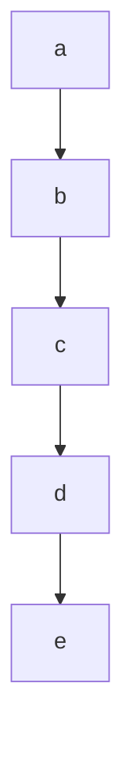

<!-- SPDX-License-Identifier: CC-BY-4.0 -->
# nodespec — specification, draft 0

Status: draft. This document writes up the profile that
`docs/adjudications/0001-mermaid-profile.md` (here, 0001) decides,
under its rules D1 to D5. **Where this document and 0001 disagree,
0001 wins and this document is in error.** Where 0001 is silent on
something the grammar has to decide, the text takes a reading, marks
it **(provisional)**, and lists it in §12. Each provisional reading
waits for the owner.

There is no conformance suite yet. Its cases are to be written from
this text alone, by someone who has not written a checker, and a
reference checker is then run against them unchanged, under a mutation
gate (0001, *What is decided already*). Every rule below is meant to be
decidable from this text without reading Mermaid's source.

---

## 1. What this format is for

A diagram of named nodes that several people edit, in git, over years,
where a merge that is quietly wrong about which nodes exist is worse
than a merge that fails.

Every nodespec file is a Mermaid flowchart. nodespec adds rules; it
adds no syntax (0001). The rules make loud the silent wrong merge that
`existence/RESULT.md` found: one branch renames or deletes a name, the
other still uses it, and Mermaid, which makes a node of any name an
edge uses, shows nothing. Under D1 the merged file names an id that no
statement declares, and the file is refused.

## 2. What this document decides

Specified here: the accepted file, as a grammar (§3, §4); what declares
an id and what names one (§5); membership (§6); the order rule (§7);
how a file is checked (§8); and the refusals, each with an identifier
(§9).

Not specified: how Mermaid lays out or renders a file; what a label
says, or how Mermaid renders its text; editor behaviour; how a refusal
is worded; and how a tool merges. A checker accepts a file or refuses
it; the profile defines no other value.

**Mermaid** in this document means Mermaid 12.1.0, as
`spike/mermaid/PRE-REGISTRATION.md` §4.4 pins it: Node v24.20.0,
`mermaid@12.1.0` and `jsdom@26.1.0` from the committed lockfile,
`securityLevel: "strict"`, `flowchart.htmlLabels: false` and
`maxEdges: 100000`. Each statement here about what Mermaid does was
checked against that install. The grammar is written so that every
file it accepts parses in Mermaid, with the nodes, edges, edge ids,
members, directions and classes this document reads from it. A file
this document accepts that Mermaid reads otherwise is a defect in this
document.

A nodespec file is one whole file holding one flowchart, conventionally
named `*.mmd` **(provisional)**. A Mermaid fence inside a Markdown file
is outside draft 0.

## 3. Encoding and lines

**A file is UTF-8 (provisional).** Bytes that are not well-formed
UTF-8 are refused as `bad-encoding`.

**A file that begins with a byte-order mark is refused as `leading-bom`
(provisional).** Mermaid ignores a leading U+FEFF. Refusing it now can
be relaxed later without making any accepted file invalid.

A line ends at LF, or at CR followed by LF; the line ending is not part
of the line. The last line need not end with one. **A CR that is not
followed by LF is refused as `lone-cr` (provisional).** Mermaid reads a
lone CR as a line end and git does not, so to git a file whose lines
end in CR is one line, and every two edits to it touch the same line.

`WSP` is a space (U+0020) or a tab (U+0009), and nothing else. Other
whitespace characters, such as U+00A0, never match `WSP`.

Nothing is normalised. Ids and keywords compare exactly, by code point,
so `End` and `end` are different words.

## 4. The grammar

### 4.1 Notation, and the whole grammar

ABNF (RFC 5234). **String literals are case-sensitive**, as RFC 7405's
`%s` prefix marks them; this document leaves the prefix out for
readability. `ALPHA` and `DIGIT` are ASCII letters and digits only;
`HEXDIG` is `DIGIT` or `A` to `F` in either case.

```abnf
WSP          = SP / HTAB
lchar        = HTAB / %x20-21 / %x23-27 / %x2A-3F / %x41-5A / %x5C
             / %x5E-7A / %x7E / nonascii
               ; a label character: not [ ] ( ) { } | " @
lead         = %x21 / %x23-27 / %x2A-2C / %x2E / %x30-3F / %x41-5A
             / %x5E-7A / %x7E / nonascii
               ; an lchar that is not WSP, - / or \
qchar        = HTAB / %x20-21 / %x23-7E / nonascii   ; not "
nonascii     = %xA0-D7FF / %xE000-10FFFF
cchar        = HTAB / %x20-7E / nonascii

id           = 1*( ALPHA / DIGIT / "_" )                  ; §4.4
dir          = "TB" / "TD" / "BT" / "LR" / "RL"

blank        = *WSP
comment      = *WSP "%%" ( HTAB / %x20-7A / %x7C-7E / nonascii )
               *cchar                       ; next is not "{"
header       = *WSP ( "flowchart" / "graph" ) [ 1*WSP dir ] *WSP

node-stmt    = *WSP id shape *WSP                         ; §4.5
shape        = "[" label "]"     / "(" label ")"
             / "([" label "])"   / "[[" label "]]"
             / "[(" label ")]"   / "((" label "))"
             / ">" label "]"     / "{" label "}"
             / "{{" label "}}"   / "[/" label "/]"
             / "[\" label "\]"   / "[/" label "\]"
             / "[\" label "/]"   / "(((" label ")))"
label        = unquoted / quoted
unquoted     = *WSP lead *lchar
quoted       = DQUOTE 1*qchar DQUOTE

edge-stmt    = *WSP group 1*( 1*WSP [ id "@" ] link
               [ "|" label "|" ] 1*WSP group ) *WSP       ; §4.6
group        = id *( 1*WSP "&" 1*WSP id )
link         = 2*"-" ">" / 3*"-" / 2*"-" "o" / 2*"-" "x"
             / "<" 2*"-" ">" / "o" 2*"-" "o" / "x" 2*"-" "x"
             / "-" 1*"." "->" / "-" 1*"." "-"
             / 2*"=" ">" / 3*"="
             / 3*"~"
edge-decl    = *WSP dgroup 1*( 1*WSP [ id "@" ] link
               [ "|" label "|" ] 1*WSP dgroup ) *WSP
dgroup       = dend *( 1*WSP "&" 1*WSP dend )
dend         = id [ shape ]

subgraph-line = *WSP "subgraph" 1*WSP id [ *WSP "[" label "]" ]
                                                          ; §4.7
end-line     = *WSP "end" *WSP
member-line  = *WSP id *WSP
direction-stmt = *WSP "direction" 1*WSP dir *WSP

classdef-stmt = *WSP "classDef" 1*WSP id 1*WSP style-list *WSP
class-stmt   = *WSP "class" 1*WSP id *( "," id ) 1*WSP id
style-stmt   = *WSP "style" 1*WSP id 1*WSP style-list *WSP
style-list   = style-item *( "," style-item )             ; §4.8
style-item   = name ":" *SP value
value        = word *( 1*SP word )
word         = colour / number / [ "!" ] name
colour       = "#" 1*HEXDIG
number       = ( [ "-" ] 1*DIGIT [ "." 1*DIGIT ] / "." 1*DIGIT )
               [ unit ] [ "%" ]
unit         = 1*%x61-7A
name         = ALPHA *( ALPHA / DIGIT / "_" )
               *( "-" 1*( ALPHA / DIGIT / "_" ) )
```

A production matches a line only if it matches the whole line. Two
constraints that ABNF does not carry are part of the productions, so a
line that breaks one does not match:

- a `quoted` label holds at least one character that is not `WSP`, does
  not begin with `` ` ``, and does not end with `=` (§4.5);
- a `unit` is not `v`, and a `name` is not `v`, does not begin with
  `v-`, and is not a reserved word (§4.8).

Two more are refusals of their own: an `id` that is reserved, in a line
that matches, is `reserved-id` (§4.4); and text that Mermaid reads as a
direction statement, in any line but a comment or a direction
statement, is `stray-direction` (§4.9).

### 4.2 Lines

Each line is classified by the first rule below that matches it. A line
that is classified is never also read as something else.

1. **A conflict marker**: the line's first seven characters are seven
   `<`, seven `=`, seven `>` or seven `|`. Refused as
   `conflict-marker`.
2. **A blank line** matches `blank`. It is allowed anywhere.
3. **A comment** matches `comment`. It is allowed anywhere, inside a
   block included, and is otherwise ignored. A comment has its own
   line: Mermaid refuses `%%` after a statement on the same line. A
   line holding only `%%`, with nothing after it, is not a comment;
   Mermaid reads it as a node named `%%`.
4. **A directive**: the line begins, after `WSP`, with `%%{`. Refused
   as `not-admitted` (§4.10).
5. Every other line is a **statement line**. The first statement line
   of a file must match `header` (§4.3); later statement lines are
   classified by §4.3's rules.

### 4.3 The header, and statement lines

**The first statement line is the header**: `flowchart` or `graph`,
then optionally a direction. Blank lines and comments may come before
it. A file with no statement line, or whose first statement line does
not match `header`, is refused as `no-header`. So is a header in
another case (`Flowchart`), with another direction (`td`, `<`, `v`),
with `flowchart-elk`, or with a `;` after it. The direction is
optional, as in the spike's subset **(provisional)**.

`flowchart-elk` is not admitted **(provisional)**. It
chooses a layout engine, which Mermaid also lets configuration choose,
and configuration is not admitted (§4.10).

After the header, the **first word** of a statement line is its text
after leading `WSP`, up to the next `WSP` or the end of the line. *In a
block* means after a subgraph line that opened a block and before the
`end-line` that closes it (§4.7); everywhere else is the *top level*.
A statement line is classified by the first rule below that applies:

1. First word `subgraph`: in a block, `nested-block`, whether or not
   the line is well formed. At the top level, §4.7: it opens a block,
   or is `subgraph-without-id`, or is `malformed-line`.
2. First word `end`: if the line matches `end-line`, it closes the
   open block, or at the top level is `unbalanced-block`. Otherwise
   `malformed-line`.
3. First word `direction`: if the line matches `direction-stmt`, it is
   a direction statement in a block (§4.9), or at the top level
   `direction-outside-block`. Otherwise `malformed-line`.
4. First word `classDef`, `class` or `style`: in a block,
   `statement-in-block`. At the top level, if the line matches
   `classdef-stmt`, `class-stmt` or `style-stmt` for its first word, it
   is that statement (§4.8); otherwise `malformed-line`.
5. First word `linkStyle`: `link-style`.
6. First word `click`; or the line begins, after `WSP`, with `accTitle`
   then `:`, or with `accDescr` then `:` or `{`, with any `WSP` between
   them: `not-admitted`.
7. Matches `node-stmt`: in a block, `declaration-in-block`; at the top
   level, a node statement, which declares a node (§5.1).
8. Matches `edge-stmt`: in a block, `statement-in-block`; at the top
   level, an edge statement (§4.6).
9. Matches `edge-decl`: in a block, `statement-in-block`; at the top
   level, `declaration-in-edge`.
10. Matches `member-line`: in a block, a member line (§6); at the top
    level, `malformed-line`.
11. Holds `:::` or `@{`, or a `"` directly followed by `` ` ``:
    `not-admitted`.
12. Anything else: `malformed-line`.

A file that ends inside a block is refused as `unbalanced-block`.

A bare id at the top level matches `member-line`, and is
`malformed-line` there. It is not a declaration: a declaration names a
shape (0001, *What it costs*).

`;` is not admitted anywhere outside a label **(provisional)**, so a
statement line ending in `;`, two statements on one line, and a member
line `a;` are `malformed-line`, and a header ending in `;` is
`no-header`. Mermaid accepts `;` as a statement separator, and reads it
differently by statement: `graph TD ;` does not parse, and in a
`classDef` it joins two styles into one.

### 4.4 Ids

An id is one or more ASCII letters, digits and underscores. Mermaid
accepts more, including `-`, `.` and non-ASCII letters; the profile
does not **(provisional)**. Mermaid reads a word such as `end` or
`class` before a hyphen as its keyword, so `end-x[E]` and `class-a[E]`
do not parse; and `a&b --> c` makes one node named `a&b`.

**An id is refused as `reserved-id`** when it is one of these words,
compared exactly:

    end  graph  flowchart  subgraph  style  class  classDef  click
    linkStyle  interpolate  call  href  default  _self  _blank
    _parent  _top

Each is a Mermaid keyword: in at least one of the positions an id
takes (a node statement, an edge end, a member line, a subgraph id, an
edge id, a class, a class or style target), Mermaid does not parse it
or reads it as something else. `default` is among them, so
`classDef default`, Mermaid's class for every node, is refused
**(provisional)**.

**`direction` is reserved too (provisional)**, and refused as
`reserved-id`. Mermaid accepts it as an id, but a line whose first word
is `direction` is read as a direction statement (§4.3), and one that
ends in it is `stray-direction` (§4.9), so as an id it would work in
some places and not others.

**An id of the form `L_`, one or more characters, `_`, one or more
characters, `_`, one or more digits, such as `L_a_b_0`, is refused as
`reserved-id` (provisional).** Mermaid gives every edge without an
edge id an id of that form, `L_` start `_` end `_` a counter. A node
statement whose id equals an existing edge's id is dropped without a
word; a node declared before the edge keeps its id, and a `class`
naming it then classes the node and the edge.

`reserved-id` applies wherever an id stands in a line that matches a
production: in a declaration and wherever it is named.

### 4.5 Node statements and labels

A **node statement** is an id and a shape, with nothing between them:
`a [A]` does not parse in Mermaid. The shapes are Mermaid's classic
fourteen:

| shape | Mermaid's type | | shape | Mermaid's type |
| --- | --- | --- | --- | --- |
| `a[A]` | square | | `a{A}` | diamond |
| `a(A)` | round | | `a{{A}}` | hexagon |
| `a([A])` | stadium | | `a[/A/]` | lean_right |
| `a[[A]]` | subroutine | | `a[\A\]` | lean_left |
| `a[(A)]` | cylinder | | `a[/A\]` | trapezoid |
| `a((A))` | circle | | `a[\A/]` | inv_trapezoid |
| `a>A]` | odd | | `a(((A)))` | doublecircle |

**A label is unquoted or quoted.** An unquoted label has at least one
character that is not `WSP`; its first such character is not `-`, `/`
or `\`, since `(-`, `[/` and `[\` open other shapes; and it holds none
of `[ ] ( ) { } | " @`. A quoted label is `"`, then text without `"`,
then `"`, with nothing between the quotes and the delimiters around
them.
The text holds a character that is not `WSP`, and:

- does not begin with `` ` ``: `` "`…`" `` is a Markdown string,
  which is not admitted (§4.10);
- does not end with `=`. Before Mermaid parses a file it rewrites
  `="…"` to `='…'` between a `<` followed by a word character and the
  next `>`, wherever they are in the file; a quoted label ending in
  `=` makes `="` with its own closing quote, and the next label's
  opening quote is rewritten. Without `="` in the file the rewrite
  changes nothing.

`@` is left out of unquoted labels because Mermaid reads a run of
characters ending in `@` as an edge id, so `n[a@b]` does not parse;
quoted, `n["a@b"]` does.

**Labels are not identity.** The rules in §5 to §7 never read a label.
Mermaid trims a label's leading and trailing whitespace, and sanitises
text that looks like HTML: it reads `a[x<b]` as the text `x`. Those
are matters of rendering, which this document does not specify (§2).

### 4.6 Edge statements

An **edge statement** is a group of ids, then one or more links, each
followed by a group. A link may carry an edge id directly before it,
`a e1@--> b`, and a label directly after it, `a -->|yes| b`. Links and
`&` have `WSP` on both sides **(provisional)**: Mermaid also reads
`a-->b`, but without the spaces `A---oB` is a circle-headed link to `B`
and `a&b` is one node.

| link | Mermaid's kind |
| --- | --- |
| `-->`, `--->`, … | arrow, solid |
| `---`, `----`, … | open, solid |
| `--o`, `--x`, `---o`, … | circle or cross head, solid |
| `<-->`, `o--o`, `x--x`, `<--->`, … | both ends headed, solid |
| `-.->`, `-..->`, … | arrow, dotted |
| `-.-`, `-..-`, … | open, dotted |
| `==>`, `===>`, … | arrow, thick |
| `===`, `====`, … | open, thick |
| `~~~`, `~~~~`, … | invisible |

These are the spike's links (`spike/mermaid/PRE-REGISTRATION.md`,
Appendix A) with their longer forms. Mermaid accepts others that are
not admitted **(provisional)**: `<-.->`, `<==>`, `o-.-o` and `x==x`;
and a head at the start only, `o-->`, `x-->` or `<---`, which Mermaid
reads without that head. They are `malformed-line`. So is a label
written inside the link, `-- yes -->`, `-. yes .->` or `== yes ==>`
**(provisional)**: the pipe form says the same, and the inline form's
label ends at the first run of the link's own characters.

**What edges a statement makes.** Each link makes one edge from every
id of the group before it to every id of the group after it:
`a & b --> c & d` makes four edges, and `a --> b --> c` makes two. Two
statements may make the same edge; Mermaid keeps both.

**An edge id is declared by the one edge that carries it** (D1). So an
edge id is allowed only on a link with one id on each side. **An edge
id on a link with `&` in the group before it or after it is refused as
`edge-id-on-group` (provisional).** Mermaid gives the id to one edge of
the group, from the group's last start to its first end, and the
others get automatic ids; an edit that adds an id to the group moves
the edge id to another edge without a word.

### 4.7 Subgraph blocks

A **subgraph line** opens a block, and the next `end-line` closes it.
Blocks do not nest (D3, §6). A subgraph line is `subgraph`, its
explicit id, and optionally a title in `[ ]`: `subgraph cache`,
`subgraph cache [Cache tier]`, `subgraph cache["Cache tier"]`. The
title is a label (§4.5). **Nothing follows the title or the id, not
even `WSP`.** Mermaid refuses `subgraph s [T]` followed by a space, and
reads `subgraph s` followed by a space as a subgraph with no id, titled
`s`.

**A subgraph line with no explicit id is refused as
`subgraph-without-id`** (D1). It is a line whose first word is
`subgraph` and in which, after `subgraph` and the `WSP` that follows,
the text is empty, or begins with `"`, or holds `WSP` before its first
`[` (or anywhere, if it has none) that is not followed, after any more
`WSP`, by that `[`. Those are the forms Mermaid gives an id of its own:
`subgraph`, `subgraph My Title`, `subgraph "My Title"`, and
`subgraph s ` with a trailing space. Any other top-level line whose
first word is `subgraph` and that does not match `subgraph-line` is
`malformed-line`.

`end-line` is `end` alone. Mermaid reads `end x` as the end of the
block and a node `x`.

### 4.8 `classDef`, `class` and `style`

`classDef c fill:#f9f,stroke:#333` declares the class `c` with a style
list. `class a,b c` gives the class `c` to `a` and `b`.
`style a fill:#f9f` styles `a`. Each statement is at the top level
(D3); what each may name is §5.2.

One statement, one class, one style target **(provisional)**:

- `classDef c1,c2 …`, which Mermaid reads as two classes, is
  `malformed-line`; each class has its own `classDef` line.
- `class a c1,c2` is `malformed-line`: Mermaid gives `a` one class
  named `c1,c2`.
- `style a,b …` is `malformed-line`: Mermaid styles a new node named
  `a,b`.

A `class` line ends at its class id: Mermaid refuses `WSP` after it.
`classDef` and `style` lines may end in `WSP`, which Mermaid keeps in
the last style.

**A style list** is narrower than what Mermaid accepts
**(provisional)**. Mermaid lexes a style as tokens of the diagram, so
a value that holds `--`, `-.`, `&`, `:::`, `==`, `>`, `(`, `"`, `@`, a
keyword, or the word `v` after a digit or `#` does not parse, and `;`
joins two styles into one. The grammar admits CSS-like items: a name,
`:`, and words that are a colour (`#f9f`), a number with an optional
unit and `%` (`4px`, `.5`, `50%`), or a name (`Arial`, `sans-serif`,
`!important`). A `unit` is lower-case letters other than `v`. A `name`
is not `v`, does not begin with `v-`, and is not a reserved word
(§4.4).

### 4.9 Direction

A **direction statement**, `direction LR`, sets a block's direction.
It stands only in a block **(provisional)**: at the top level it is
refused as `direction-outside-block`. Mermaid accepts it there and it
has no effect; the header carries the chart's direction. **A block
holds at most one direction statement (provisional)**: a second is
refused as `direction-twice`. Mermaid keeps the last, so two branches
that each add one merge clean and one of them is lost.

**Text Mermaid reads as a direction statement is refused as
`stray-direction`.** Mermaid's lexer reads any text that matches
`direction`, one or more whitespace characters, and one of `TB`, `BT`,
`RL`, `LR` or `TD`, as a direction statement, from wherever a token
starts to the end of that line; the whitespace may include line ends.
What it swallows is gone: `a[go direction LR]` declares no node, an
edge labelled `|direction RL|` is no edge, and a member line ending
in `direction` followed by a line starting with `LR` holds neither. So
a line other than a comment or a line that matches `direction-stmt` is
refused as `stray-direction` when:

- it holds `direction`, then one or more whitespace characters, then
  `TB`, `BT`, `RL`, `LR` or `TD`; or
- with trailing whitespace removed, it ends in `direction`.

Here a whitespace character is any of U+0009 to U+000D, U+0020,
U+00A0, U+1680, U+2000 to U+200A, U+2028, U+2029, U+202F, U+205F,
U+3000 and U+FEFF, which is what Mermaid's lexer counts; U+00A0 between
the words swallows the line as a space does. The text may stand
anywhere in the line: in a label, a title, a style, an id
(`xdirection LRX` matches). `stray-direction` applies whatever else
applies to the line. Comment lines are exempt because Mermaid removes
them before it lexes.

### 4.10 Not admitted, for now

0001 leaves open which Mermaid statements beyond the spike's subset the
profile admits (*Open, for the specification and its cases*). Until
each is decided with its reason, the profile refuses it. That can be
relaxed later without making any accepted file invalid.

Refused as `not-admitted`:

- **Front matter**, a file whose first line is `---`. Its first
  statement line is then not a header, so `no-header` applies too, and
  either is a correct report (§9).
- **Directives**, a line beginning `%%{`. Front matter and directives
  configure how Mermaid reads and draws the rest of the file, and the
  rules here were checked under one fixed configuration (§2).
- **`click`**, which attaches a link or a callback to a node; the
  spike's model carried it only as text (0001 names it open).
- **`accTitle` and `accDescr`**, which are not in the spike's subset.
- **`:::`**, a class given inside a node or edge statement
  **(provisional)**. A class has one form, the `class` statement, which
  D4 orders; `a:::c --> b` would give a class from an edge statement,
  which D1 says names and declares nothing.
- **`@{ … }`**, Mermaid's newer shape and edge data form
  **(provisional)**. Its body is a YAML mapping that the grammar would
  have to pin, and on an edge id it changes that edge.
- **Markdown strings**, `` "`…`" `` in a label or a title, which the
  spike's subset left out.

A line is `not-admitted` only as §4.2 and §4.3 say. Other forms
Mermaid accepts and this grammar does not, such as `;`, `-- text -->`,
the other links, other ids, `classDef c1,c2` and `class a c1,c2`, are
`malformed-line`.

## 5. Declarations and names (D1, D2)

### 5.1 Declarations

**D1. Every id is declared exactly once, and everything else only
names it.** An id is declared by:

| declaration | kind |
| --- | --- |
| a node statement, at the top level | node |
| a subgraph line | subgraph |
| `id@` before a link in an edge statement | edge |
| a `classDef` line | class |

A node statement stands on its own line, outside every block. A
declaration inside an edge, `api[API] --> db`, matches `edge-decl` and
not `edge-stmt`, and is refused as `declaration-in-edge`: an edge that
could declare its end would let the other branch quietly redeclare a
node it renamed (0001, *Why*). A node statement inside a block is
`declaration-in-block` (§6).

**An id declared twice as the same kind is refused as
`duplicate-declaration`**: two node statements for `a`, two subgraph
lines for `s`, `e1@` on two links, two `classDef` lines for `c`. This
holds however alike the two declarations are. Mermaid would merge each
pair: a node keeps its last label and shape, a subgraph id fuses two
subgraphs, a second `e1@` gives that edge an automatic id instead, and
two `classDef` lines join their styles.

### 5.2 Names

Every other place an id stands names it. A name must be declared, by a
declaration anywhere in the file, before or after it, except as §7
orders `class`. **An id that is named and not declared is refused as
`undeclared-id`.**

| statement | names | each may be |
| --- | --- | --- |
| edge statement | each id of its groups | node or subgraph (*) |
| member line | its id | node or subgraph (D3) |
| `style` | its target | node or subgraph (D1) |
| `class` | each target | node, subgraph or edge (D1) |
| `class` | its last id, the class | class |

(*) The subgraph is **(provisional)**; see below. A `class`
statement's targets are the ids before its last one.

**A statement that names an id declared as a kind it may not name is
refused as `wrong-kind`**: `style e1 …` where `e1` is an edge id, since
Mermaid drops a style on an edge without a word; `class a b` where `b`
is a node; an edge to an edge id or a class; a member line naming an
edge id. Mermaid accepts each and reads something other than what it
says: an edge to an edge id ends at no node, and an edge to a class
makes a node with the class's name.

0001's example is an edge between two nodes, and D1 says an edge names
declared ids. Mermaid accepts an edge to a subgraph, and the profile
admits one **(provisional)**. D1 still holds for it: an edge to a
subgraph that the other branch deleted names an undeclared id.

### 5.3 One id, one kind

**D2. An id names a node, a subgraph, an edge or a class, never two of
them.** One namespace holds every id. **An id declared as two kinds is
refused as `kind-clash`**: a node and a subgraph both named `cache`, a
node and an edge id `e1`, a class and a node. Mermaid keeps both a
node and a subgraph of one name (the existence candidate 06, the
spike's I4), and drops a node statement whose id is an edge id
declared above it.

### 5.4 An example (not normative)

Under the profile, existence candidate 09 starts from



One branch deletes `c`, its node statement and its two edges; the other
adds `e --> c` after the last edge. Git merges them without a conflict,
and the merged file declares no `c` while `e --> c` names it. It is
refused as `undeclared-id` for `c`.

## 6. Membership (D3)

**D3. Membership is a member line.** Every block stands at the top
level. A block holds only member lines, direction statements, comments
and blank lines (§4.3):

- a node statement in a block is refused as `declaration-in-block`;
- an edge statement, or a `classDef`, `class` or `style` statement, in
  a block is refused as `statement-in-block`; an `edge-decl` in a block
  is `statement-in-block` too;
- a subgraph line in a block is refused as `nested-block`;
- an `end-line` with no open block, and a file that ends inside a
  block, are refused as `unbalanced-block`.

**A member line names one declared node or subgraph**, and makes the
block's subgraph its **holder**. A member line naming a subgraph nests
that subgraph in the block's subgraph. Mermaid nests a subgraph named
on a member line as it nests a block written inside another, whichever
of the two blocks comes first in the file. A member line holds one id:
Mermaid reads `a & b` in a block, and it is `malformed-line` here.

**A node or a subgraph has at most one holder.** An id named by more
than one member line is refused as `member-twice`. Where the two lines
are in two blocks, that is D3. Where both are in one block, refusing it
is **(provisional)**: the two lines say the same thing, and a later
edit that deletes one leaves the other. Mermaid puts an id named in two
blocks in whichever block it closes first, and says nothing.

**Nesting has no cycle.** Following holders from a subgraph never
returns to it. A cycle is refused as `membership-cycle`; a member line
naming its own block's subgraph is a cycle of one. Mermaid does not
refuse a cycle (0001).

## 7. Position (D4)

**D4. Nothing depends on position.**

**`linkStyle` is refused as `link-style`.** It styles edges by their
index in file order, so an edge added above it on another branch
silently restyles a different edge (0001).

**A `class` statement comes after the declaration of every id it
names.** Mermaid drops a class given to a node, subgraph or edge not
yet declared; with class lines last, moving a declaration cannot strip
its class (0001). A `class` line that comes before the line declaring
an id it names is refused as `class-before-declaration`. The lines that
declare are §5.1's: a node statement, a subgraph line, the edge
statement holding `id@`, and the `classDef` line.

The class a `class` statement gives is one of the ids it
names, so its `classDef` line comes first too **(provisional)**. That
is D4 as 0001 words it, "every id it names". Mermaid itself applies a
class whose `classDef` comes later.

D4 orders nothing else. Declarations, edges, blocks and `style` lines
may come in any order: Mermaid creates a node that an edge, a member
line or a `style` names before its node statement, and the node
statement then gives it its label and shape.

## 8. Checking one file (D5)

**D5. The profile is checked, and refused, on the file alone.** A
checker reads one file and says either that it is in the profile or
which rule it breaks and, where the rule is about an id, which id. It
repairs nothing. A merge is checked by checking its result.

A checker needs no merge driver, clean or smudge filter, or hook, which
do not travel (rowspec `SPEC.md` §11). It needs no Mermaid either:
every rule here is a property of the file's text.

## 9. Refusals — normative

A file is either in the profile or refused. **This list is complete**:
every refusal draft 0 has is below. Each entry gives the identifier,
what it means, and the section it comes from.

A checker MUST refuse:

1. `bad-encoding`: bytes that are not well-formed UTF-8 (§3)
2. `leading-bom`: a byte-order mark at the start of the file (§3)
3. `lone-cr`: a CR not followed by LF (§3)
4. `conflict-marker`: a line that starts with seven `<`, `=`, `>` or
   `|` (§4.2)
5. `no-header`: no statement line, or a first one that is not a header
   (§4.3)
6. `malformed-line`: a statement line §4.3 sends to no other entry
   (§4.3)
7. `not-admitted`: front matter, a directive, `click`, `accTitle`,
   `accDescr`, `:::`, `@{` or a Markdown string (§4.10)
8. `reserved-id`: an id that is a reserved word or has the form of an
   automatic edge id (§4.4)
9. `stray-direction`: text Mermaid would read as a direction statement
   where none stands (§4.9)
10. `subgraph-without-id`: a subgraph line with no explicit id (§4.7,
    D1)
11. `declaration-in-edge`: a node declared inside an edge statement
    (§5.1, D1)
12. `duplicate-declaration`: an id declared twice as one kind (§5.1,
    D1)
13. `undeclared-id`: an id named and declared nowhere (§5.2, D1)
14. `wrong-kind`: an id named where its kind may not be named (§5.2,
    D1, D2)
15. `kind-clash`: an id declared as two kinds (§5.3, D2)
16. `edge-id-on-group`: an edge id on a link with `&` on either side
    (§4.6, D1)
17. `declaration-in-block`: a node statement in a block (§6, D3)
18. `statement-in-block`: an edge, `classDef`, `class` or `style`
    statement in a block (§6, D3)
19. `nested-block`: a subgraph line in a block (§6, D3)
20. `unbalanced-block`: an `end` with no open block, or a block never
    closed (§4.3, §6)
21. `member-twice`: an id on more than one member line (§6, D3)
22. `membership-cycle`: subgraphs that hold one another (§6, D3)
23. `direction-outside-block`: a direction statement at the top level
    (§4.9)
24. `direction-twice`: a second direction statement in one block
    (§4.9)
25. `link-style`: a `linkStyle` line (§7, D4)
26. `class-before-declaration`: a `class` line before the declaration
    of an id it names (§7, D4)

**Every refusal is reported with its identifier**, spelled exactly,
where a program can read it without parsing the message. The message
is free. **Some entries are about an id**, and are reported with one id
they apply to:

- `reserved-id`, `duplicate-declaration`, `undeclared-id`,
  `wrong-kind` and `kind-clash`: the id itself;
- `edge-id-on-group`: the edge id;
- `member-twice`: the id named on more than one member line;
- `membership-cycle`: a subgraph on the cycle;
- `class-before-declaration`: the id whose declaration comes after the
  `class` line.

The other entries are about a line or the whole file, and carry no id.

**Several refusals may apply to one file, and which one is reported is
not specified**, as in rowspec §9. A checker reports any one that
applies, with an id it applies to where the entry has one. A
conformance case names every identifier that applies to its file, and
for each entry about an id, every id it applies to; a report passes if
its identifier, and its id where the entry has one, are among them. A
checker MUST be deterministic: the same bytes give the same report on
every run.

An identifier is a name, not a number, and is never reused for a
different refusal. The numbering is not a precedence order.

## 10. Conformance

The suite does not exist yet. When it does, a case is a directory of
exact bytes holding one input file and one `expect.json`: either the
file is in the profile, or the identifiers that apply to it, each with
its ids where the entry has them (§9). A checker conforms when it
reports what each case expects. Every input a case accepts is a Mermaid
flowchart, and the suite's tooling can check that each parses in
Mermaid as §2 pins it.

Merge cases, if the suite has them, check the merged file as one file
(D5): stock git's result is checked, not git's exit status.

## 11. What this does not prevent (not normative)

0001 names four merges that are clean, stay in the profile, and that no
rule over one file can tell from a deliberate edit (0001, *Not
prevented*, which has the full text):

- **An id reused for a new meaning.** One branch deletes `cache` and
  declares a different node named `cache`; the other branch's new edge
  to `cache` lands on the new node. The id is the node's identity, so
  reusing it says it is the same node.
- **The same declaration added on both branches at the same place.**
  Git keeps one line, so two authors' identical `cache[Cache]` are one
  node, with both branches' edges.
- **A delete against a move of the same declaration.** One branch
  deletes a node, an edge carrying an id, or a subgraph; the other
  moves that declaration's line. Git keeps the moved line, and the
  deleted thing comes back: a node with none of its edges, an edge
  without its `class` line, a subgraph with its member lines. A
  canonical statement order would refuse the move; draft 0 does not
  require one (0001, *Open*).
- **A class redefined** on one branch while the other assigns it: the
  assignment gets the new style.

0001 also records that Mermaid renders neither a `direction` in a
nested subgraph nor edges into a nested subgraph, whether it is nested
by a member line or by a block written inside another. The profile
admits both; they are Mermaid's limits, not merges.

## 12. Provisional, and not decided

Each reading marked **(provisional)** above is listed here. Each is
where 0001 is silent and the grammar had to say something; each waits
for the owner.

- The file is one whole `*.mmd` file; fences are outside draft 0 (§2).
- UTF-8 is required; a leading BOM and a lone CR are refused (§3).
- The header's direction is optional, and `flowchart-elk` is not
  admitted (§4.3).
- `;` is not admitted outside a label (§4.3).
- Ids are ASCII letters, digits and `_` (§4.4).
- `classDef default` is refused, with `default` reserved (§4.4).
- `direction` is reserved as an id (§4.4).
- Ids of the form `L_…_…_N` are reserved (§4.4).
- Links and `&` have `WSP` on both sides (§4.6).
- Only the spike's links are admitted, and only the pipe form of an
  edge label (§4.6).
- An edge id on a link with `&` on either side is refused (§4.6).
- One class per `classDef` and per `class` line, and one target per
  `style` line (§4.8).
- Style lists are narrower than Mermaid's (§4.8).
- A direction statement only in a block, at most one per block (§4.9).
- `:::` and `@{ … }` are not admitted (§4.10).
- An edge end may name a subgraph (§5.2).
- Two member lines naming one id in one block are refused (§6).
- A `class` line comes after the `classDef` of the class it gives
  (§7).

**Not decided**, and with no reading here:

- **A canonical statement order**, which would close the
  delete-against-move residual (0001, *Open*).
- **Which statements beyond draft 0 the profile admits**: each item of
  §4.10, with its reason.
- **How refusal identifiers evolve** beyond §9's rule that one is never
  reused: whether rowspec §9's rules for splitting, merging and
  retiring identifiers apply.
