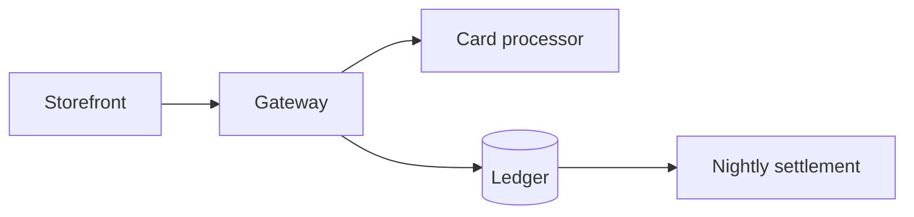

# Payments gateway

## Overview

The gateway accepts card payments from the storefront and settles them
nightly.

## Architecture

The gateway is a stateless service in front of the ledger. It keeps no
session state; every request carries a signed merchant token, and the
ledger is the only store of record. Retries are idempotent because each
request carries a client-chosen key that the ledger enforces as unique.

Card data never touches our hosts: the storefront tokenises it in the
browser and the gateway sees only the token.

## Operations

Settlement runs at 02:00 UTC. If it fails, the on-call engineer reruns it
by hand with `settle --date <yyyy-mm-dd>`; the run is safe to repeat.
Alerts fire when the settlement total differs from the processor's report
by more than one cent.

Dashboards live under Payments in the metrics service.
